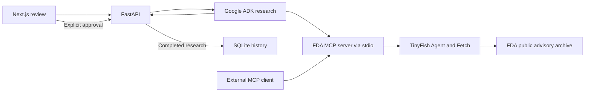

# FDA Medicine Reference MCP

A standalone, read-only MCP server for the U.S. Food and Drug Administration's Drug Safety Communications archive. The service links dated regulatory advisories and extracts bounded, source-backed passages. The archive covers selected safety issues and does not provide a complete medicine monograph, current label, interaction checker, or patient-specific guidance.

## Source qualification

- The [FDA Drug Safety Communications archive](https://www.fda.gov/drugs/drug-safety-and-availability/drug-safety-communications) publishes a public table with article titles, dates, and links. The [openFDA drug catalogue](https://open.fda.gov/apis/drug/) covers labels, adverse events, NDC, recalls, approvals, equivalents, and shortages. It does not list a historical advisory table or advisory article API. The [MedWatch RSS feed](https://www.fda.gov/safety/medwatch-fda-safety-information-and-adverse-event-reporting-program/medwatch-rss-feed) serves recent alerts and does not replace the archive and its articles.
- [FDA website policies](https://www.fda.gov/about-fda/about-website/website-policies) allow reuse of FDA-authored text unless otherwise noted and prefer links to the current source. The server identifies the FDA, dates each retrieval, and links the original. It does not return third-party documents, images, or attached PDFs.
- [FDA robots policy](https://www.fda.gov/robots.txt) permits the public drug communication paths for general crawlers and requests a 30-second crawl delay. The server spaces FDA-related TinyFish requests by at least 31 seconds across processes sharing its local pacing database. Use one host and a shared `SITE_MCP_RATE_DB` path if running several local clients.
- The live qualification checked distinct montelukast and cetirizine results through TinyFish Agent and confirmed the full montelukast communication through TinyFish Fetch. An archive miss for gabapentin establishes only that it was absent from the searched title table.

## Install and run

Requires Node.js 24 or later and a TinyFish API key with Agent and Fetch access.

```powershell
cd D:\project\medicine-autopilot\mcp-server
npm ci
npm run typecheck
npm test
node --env-file=.env server.ts
```

Create a private component-local `.env` from `.env.example` or provide `TINYFISH_API_KEY` in the process environment. The stdio server writes MCP messages to stdout. Use a client to invoke it. For example, with an inherited key, `npm run verify` runs the standalone protocol client and prints FDA-source results and the tool names.

## Tools

| Tool | Input | Structured result |
| --- | --- | --- |
| `search_medicines` | `query`, optional `limit` (1–5) | Matching advisory title, official link, archive date, retrieval time, TinyFish run ID, or `no_match` |
| `get_medicine_details` | `medicine_name`, `source_url` from search | Validated advisory identity, headline, published date when present, announcement excerpt, unavailable fields |
| `get_safety_warnings` | Same selected advisory arguments | Dated source and up to three excerpts, or `not_reported` when none are extracted |
| `check_reference_health` | Known canary `query`, such as `montelukast` | Live search, article identity, advisory section, and warning extraction checks |

Example sequence: call `search_medicines` with `{"query":"cetirizine","limit":1}`, then call both advisory tools with `{"medicine_name":"cetirizine","source_url":"<actual URL from the first response>"}`. All tools read live through TinyFish. The search uses [TinyFish Agent](https://docs.tinyfish.ai/api-reference/automation/run-browser-automation-synchronously) to inspect the live FDA table. Both article tools use [TinyFish Fetch](https://docs.tinyfish.ai/fetch-api/reference) with `ttl: 0`, then validate the returned URL and the headline and extract from the advisory section.

The health check can be run with `npm run health` when the key is in the environment. It distinguishes provider HTTP, network, timeout, and response-contract errors from site retrieval, article identity, and layout errors. If an article schema fails, inspect the archived title and article headings before changing extraction. Recover from provider errors by checking the key and quota, then retrying once after the cooldown. The server avoids replaying an ambiguous billed POST. Lookups may take over a minute. Configure the MCP host for at least a 120-second tool timeout.

## External client configuration

Use a temporary MCP configuration for Claude Code or the equivalent stdio configuration in your client. Replace paths as needed and supply the key through the client's environment or secret configuration.

```json
{
  "mcpServers": {
    "fda": {
      "type": "stdio",
      "command": "node",
      "args": ["D:/project/medicine-autopilot/mcp-server/server.ts"],
      "env": { "TINYFISH_API_KEY": "${TINYFISH_API_KEY}" }
    }
  }
}
```

For a client that does not expand environment placeholders, use Node's `--env-file=<absolute private path>` argument and omit the example `env` block.

## Medicine Autopilot integration

Set `MEDICINE_MCP_ENABLED=true` in the FastAPI environment after installing the component dependencies. The backend starts the stdio MCP server on demand and sends only the medicine name. The FDA research agent records verified evidence or an explicit unavailable, partial, or no-match state. SearchAgent and FetchAgent retrieve a DailyMed label and capture the exact fetched link. SummaryAgent receives FDA advisory evidence as context, and the existing WarningAgent and human approval path remain in the pipeline. The review page shows the published reference separately from patient-context flags.



The parent app distinguishes pending research and approved reports in its SQLite history. Do not provide patient details to the standalone tools. This prototype is informational and must not determine treatment or medication dosage.

See the [real Codex CLI tool-call transcript excerpt](EXTERNAL-CLIENT-DEMO.md), [DEMO.md](DEMO.md), [SPEC.md](SPEC.md), and [TASKS.md](TASKS.md).

See [VALIDATION.md](VALIDATION.md) for verified calls and remaining live blockers. For Codex CLI, configure the same server as a stdio MCP entry with `command`, `args`, `env_vars = ["TINYFISH_API_KEY"]`, and `tool_timeout_sec = 120`. Use an inherited key or the client's secret configuration. The signed-in Codex test and Claude test used isolated per-command settings.
